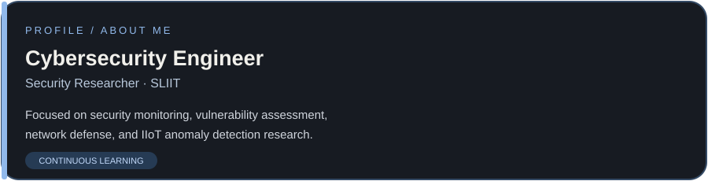
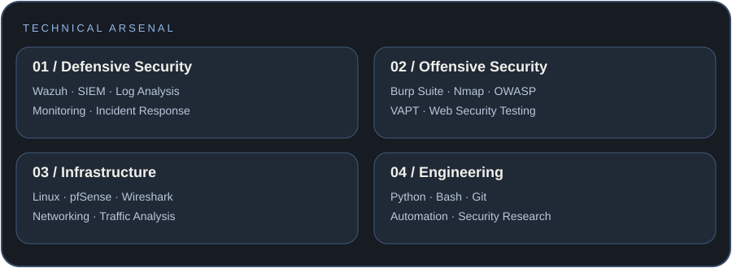
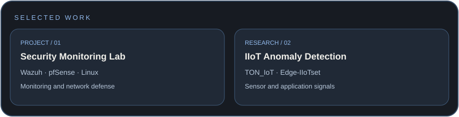
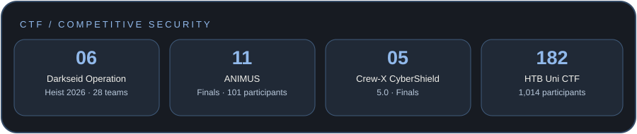

 

**Cybersecurity Engineer · Security Researcher · Continuous Learner**

*Securing infrastructure. Discovering vulnerabilities. Building resilient systems.*

---

<!-- ABOUT -->

## 01 / Technical Arsenal

---

## 02 / Featured Projects

---

## 03 / CTF & Achievements

---

## 04 / Current Learning Path

- Improving SIEM analysis and detection engineering
- Advancing web application testing and vulnerability research
- Evaluating anomaly-detection models for IIoT security
- Developing practical security automation scripts

---

## 06 / Connect

**Interested in cybersecurity engineering, security research, and collaboration.**

  

BUILD WITH PURPOSE · TEST RESPONSIBLY · SECURE BY DESIGN

